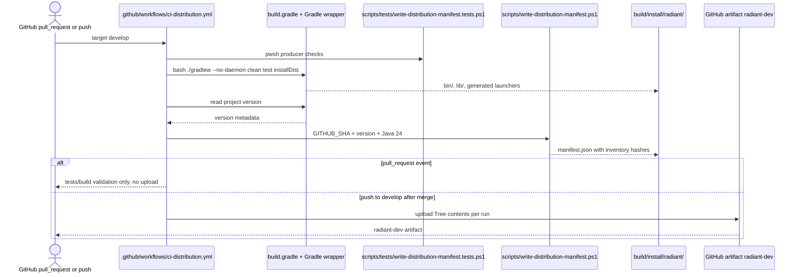
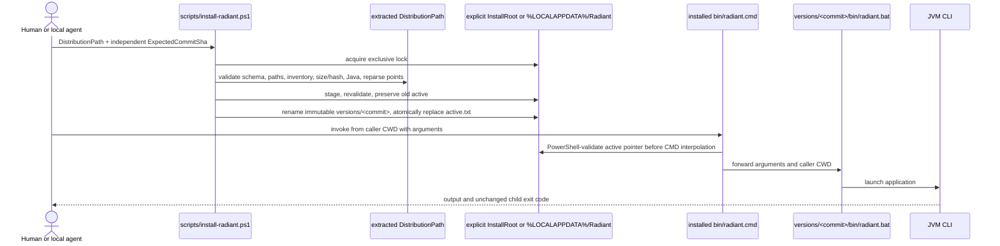
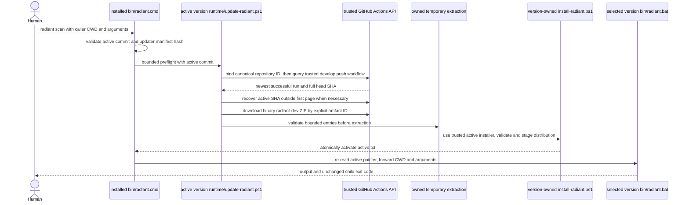

# Development distribution

PR1 produces a validated, per-run development artifact for `radiant`. PR2 adds the local Windows installer and stable launcher. PR3 adds a bounded automatic update check before the launcher executes the CLI, while preserving the active version whenever trust, network, extraction, installation, or concurrency checks fail.

## CI producer

The visible `CI - Development Distribution` workflow runs tests and `installDist` on pull requests and on pushes to `develop` using Java 24. Trusted `develop` pushes upload the contents of `build/install/radiant` as one artifact named `radiant-dev`; the Gradle ZIP is not uploaded. Pull requests build and validate without publishing a trusted artifact.

The workflow grants only `contents: read`. It derives the version from Gradle project metadata and passes the trusted full commit SHA to the manifest generator.

## Maintained flow diagrams

These diagrams are the compact producer/consumer map for humans and agents. They describe the current files and boundaries; the Windows installer test is manual and is **not** a CI step.

### CI producer



### Explicit local consumer



The manifest SHA-256 values provide integrity checks only; they do not authenticate a distribution. The trusted full `ExpectedCommitSha` is supplied independently by the updater from the validated workflow run metadata. The CI artifact is extracted into an owned temporary directory before the version-owned installer validates and activates it.

### Automatic consumer



The updater accepts only `JuanCarlosLF/radiant-dev-tools`, its canonical repository ID, `.github/workflows/ci-distribution.yml`, `develop`, `push`, a completed successful run, its full 40-character `head_sha`, and the exact non-expired `radiant-dev` artifact whose workflow-run repository IDs and SHA match. Pull-request, fork, unrelated-workflow, stale, malformed, or ambiguous metadata is rejected. If the active SHA is outside the first 100 runs, a bounded `head_sha` lookup recovers it before selecting a newer run. The binary ZIP is captured from `gh` stdout without shell redirection or `--output`; only the already authenticated, manifest-hashed installer from the active version is executed. The process timeout and output sizes are bounded, credentials are never printed, and a tampered active updater is skipped by the stable wrapper.

## Responsibility map

| Path or actor | Responsibility and communication |
|---|---|
| [`ci-distribution.yml`](../.github/workflows/ci-distribution.yml) | Runs producer tests/builds for pull requests and `develop` pushes; uploads only the merged-`develop` `radiant-dev` artifact. |
| [`build.gradle`](../build.gradle) | Defines the `radiant` application and Java 24 Gradle build consumed by `installDist`. |
| [`write-distribution-manifest.ps1`](../scripts/write-distribution-manifest.ps1) | Receives explicit commit/version/Java inputs and writes `build/install/radiant/manifest.json`. |
| [`write-distribution-manifest.tests.ps1`](../scripts/tests/write-distribution-manifest.tests.ps1) | Exercises producer manifest behavior; currently run by CI. |
| [`install-radiant.ps1`](../scripts/install-radiant.ps1) | Consumes an extracted tree plus trusted SHA, validates and stages it, then activates an immutable version. |
| [`update-radiant.ps1`](../scripts/update-radiant.ps1) | Binds the canonical repository/run/artifact metadata, downloads binary output through `gh`, validates bounded ZIP entries, and delegates activation only to the manifest-hashed installer owned by the active version. |
| [`install-radiant.tests.ps1`](../scripts/tests/install-radiant.tests.ps1) | Manual Windows proof for installer, pointer, launcher, rollback, and packaged CLI behavior; CI does not run it. |
| [`update-radiant.tests.ps1`](../scripts/tests/update-radiant.tests.ps1) | Exercises the updater through a controlled local `gh` mock, including happy path, trust failures, timeout, unsafe ZIPs, locks, and preservation. |
| [`radiant.cmd`](../scripts/radiant.cmd) | Stable wrapper copied to the installation `bin`; validates `active.txt` and the active updater hash before preflight, then delegates to the selected generated launcher. |
| `build/install/radiant/bin/`, `lib/`, `runtime/`, `manifest.json` | Generated producer output, version-owned installer/updater/launcher runtime, and manifest inventory; not hand-authored source. |
| `radiant-dev` artifact / updater | Artifact is per-run CI output; the updater downloads it by trusted run ID and passes the independently validated `head_sha` to the version-owned installer. |

Maintenance rule: update these diagrams and the table in the same change whenever triggers, producer/consumer paths, manifest fields, activation, or launcher flow changes. Official release/CD publication remains deferred.

## Manifest

`manifest.json` is generated inside the install tree after packaging. It records schema version `1`, application `radiant`, the full 40-character commit, project version, required Java major `24`, and every shipped regular file except itself. Inventory paths use `/`, are sorted deterministically, and include byte size plus lowercase SHA-256.

The producer rejects an incomplete distribution, missing `bin/radiant` or `bin/radiant.bat`, missing `lib/*.jar`, invalid commit identity, and reparse points before traversal. Re-running generation does not add the previous manifest to its own inventory.

## Local verification

```powershell
powershell.exe -NoProfile -ExecutionPolicy Bypass -File scripts/tests/write-distribution-manifest.tests.ps1 -TempRoot 'C:\path\to\existing\temp'
pwsh -NoProfile -File scripts/tests/write-distribution-manifest.tests.ps1 -TempRoot 'C:\path\to\existing\temp'
```

CI omits `-TempRoot` because the workflow runner provides `RUNNER_TEMP`; local execution must supply an existing temporary directory. The second command is used only when `pwsh` is already installed.

## Local installation (PR2)

Use an already extracted distribution. Its folder may be in any location, but its direct children must include `bin/`, `lib/`, `runtime/`, and `manifest.json`.

Replace both example paths below with your extracted folder's path. Replace the example SHA with the independently trusted full SHA from the successful `develop` workflow run. Do not derive it from `manifest.json` alone.

```powershell
powershell.exe -NoProfile -ExecutionPolicy Bypass -File 'C:\Downloads\radiant-dev\runtime\install-radiant.ps1' `
  -DistributionPath 'C:\Downloads\radiant-dev' `
  -ExpectedCommitSha '0123456789abcdef0123456789abcdef01234567'
```

`-DistributionPath` selects only the temporary extracted source; it does not choose where Radiant is installed. The default permanent layout is `%LOCALAPPDATA%\Radiant\versions\<commit>` with `%LOCALAPPDATA%\Radiant\bin\radiant.cmd` as the stable entry point. `-InstallRoot` is an optional destination override, not a normal prerequisite.

After verifying the installation, you may remove the downloaded ZIP and extracted source folder. Keep `%LOCALAPPDATA%\Radiant`: it contains the installed versions and future updates.

Each installed version owns `runtime/install-radiant.ps1` and `runtime/update-radiant.ps1`. The installer validates the complete source inventory, stages and revalidates it, and switches a hashed commit pointer atomically. Existing versions are never replaced or deleted, and a failed install preserves the previous active version.

The stable launcher resolves its root from its own location, not the caller's current directory. It validates the pointer, forwards quoted arguments and the caller CWD to the packaged `bin\radiant.bat`, and returns the child exit code. Missing, tampered, unsafe, or incomplete installations fail closed. The installer does not execute commands from the manifest.

Before the first install, ensure Java 24 is available. To enable automatic update checks, also ensure `gh` is available and already configured. Add `%LOCALAPPDATA%\Radiant\bin` to the user `PATH` once through the normal Windows environment UI. The installer and updater never perform that mutation, and the default user installation requires no administrator rights.

The generated `bin\radiant.bat` launcher uses `JAVA_HOME` when it is defined, before it searches `PATH`. Set `JAVA_HOME` to the JDK root, not its `bin` directory. Check both `$env:JAVA_HOME` and `java -version`: `java -version` alone does not show which JDK the launcher will select.

For example, a user `JAVA_HOME` pointing to an Android Studio JBR 21 can override Java 24 on `PATH`. Configure the user override intentionally rather than replacing Android Studio's own JBR. Changing user `JAVA_HOME` can affect other Java tools. Restart the terminal application after persistent environment changes.

Missing `gh`, offline access, timeout, invalid metadata, invalid ZIP entries, failed installation, or an update lock produces a warning and runs the current active CLI instead.

### Existing PR2 installations

An existing PR2 installation contains the old stable wrapper and cannot acquire PR3 behavior invisibly. Perform one explicit bootstrap with the PR3 distribution and the opt-in `-AllowStableLauncherUpgrade` switch, or install PR3 under a new explicit root:

```powershell
powershell.exe -NoProfile -ExecutionPolicy Bypass -File 'C:\Downloads\radiant-dev\runtime\install-radiant.ps1' `
  -DistributionPath 'C:\Downloads\radiant-dev' `
  -ExpectedCommitSha '0123456789abcdef0123456789abcdef01234567' `
  -AllowStableLauncherUpgrade
```

After that bootstrap, `radiant scan` checks for a newer trusted `develop` artifact before executing the active CLI. The updater never deletes the old version, replaces a running version, or rolls back to an older known run.

## Installer verification

```powershell
powershell.exe -NoProfile -ExecutionPolicy Bypass -File scripts/tests/install-radiant.tests.ps1 -TempRoot 'C:\path\to\existing\temp'
```

Tests use only an explicit existing temporary root and never perform a default host installation. They cover malformed metadata, trusted-commit mismatch, inventory/path/hash/size failures, reparse rejection where available, rollback, spaces, argument/CWD/exit-code preservation, and packaged CLI smoke.

## Automatic updater verification

```powershell
powershell.exe -NoProfile -ExecutionPolicy Bypass -File scripts/tests/update-radiant.tests.ps1 -TempRoot 'C:\path\to\existing\temp'
```

The updater test supplies a controlled local `gh` process and never reaches GitHub. It verifies successful wrapper-to-updater-to-installer-to-new-CLI execution, exact caller arguments and CWD, current-version no-op, missing `gh`, failed or untrusted run metadata, timeout, missing artifact, traversal/rooted/unsafe and case-colliding ZIP entries, installer failure, and concurrent-update preservation. ZIP extraction is rejected before any entry is activated. `gh` is not used as an arbitrary command source, and no manifest field is executed.
