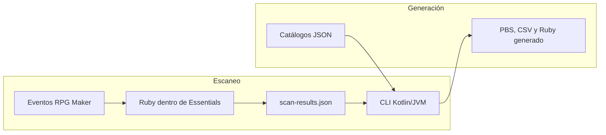

# Evolución del sistema de escaneo y progresión

> [!abstract] Objetivo
> Evolucionar el escaneo, la progresión, las MTs y los tutores sin perder la autoría desde RPG Maker. Este documento es el mapa de la propuesta: cada definición, contrato, evidencia o paso de entrega vive una sola vez en su documento propietario.

## Lectura por responsabilidad

| Si necesitas… | Consulta | Propietario |
|---|---|---|
| Evidencia del comportamiento legacy y sus límites | [Investigación histórica en GitLab](https://gitlab.com/fr0y-essentials/Radiant-Platinum-Repository/-/blob/master/radiant-platinum-docs/research/Sistema%20de%20escaneo%20y%20progresi%C3%B3n%20-%20Estado%20actual.md) | Investigación histórica |
| Campos, identidades y relaciones de negocio | [[domain-models]] | Modelos de dominio aceptados |
| Formatos JSON, invariantes, scanner y generación PBS | [[contracts]] | Contratos aceptados |
| Ubicación de código, CLI, fases, pruebas y riesgos | [[Guía de implementación]] | Plan de ejecución |

> [!important] Regla de mantenimiento
> Una decisión se escribe en su propietario y desde los demás documentos se enlaza. Este plan no replica esquemas JSON, firmas, comandos exhaustivos ni criterios de validación.

## Decisión arquitectónica

La propuesta se apoya en estas decisiones:

1. [[domain-models#stage|stage]] continúa siendo una entidad de dominio con ID estable y posición derivada.
2. [[domain-models#Capability|Capability]] expresa accesos adquiridos; ubicación, requisitos y disponibilidad efectiva son conceptos distintos.
3. Los comentarios de eventos conservan la autoría y se validan según [[contracts#Registro de objetos obtenibles|el contrato de registro]].
4. Ruby solo integra con Pokémon Essentials: lee `.rxdata`, recorre eventos y publica el resultado de escaneo.
5. Kotlin/JVM es la aplicación externa: consulta resultados, valida catálogos y genera PBS/Ruby runtime.
6. Los catálogos son fuentes de verdad versionadas; los resultados, cachés y artefactos Ruby generados son derivados.
7. El orden visible de una MT puede cambiar; su identidad es semántica (`TM_<MOVE_ID>`). Los tutores se derivan de un único catálogo.



Ruby y Kotlin/JVM no se llaman directamente. El límite inicial entre ambos es `scan-results.json`, publicado atómicamente por Ruby y leído como datos tipados por Kotlin/JVM. El alcance exacto de ese contrato está en [[contracts#Contenedor de resultados]].

## Límites y arquitectura objetivo

| Responsabilidad | Dueño | Referencia |
|---|---|---|
| Cargar mapas, recorrer páginas, detectar y publicar resultados | Ruby dentro de Essentials | [[contracts#Acceso a mapas]], [[contracts#Recorrido de mapas]] |
| Consultar resultados, resolver disponibilidad y renderizar informes | Kotlin/JVM | [[contracts#Resolución de disponibilidad]], [[Guía de implementación#CLI]] |
| Validar catálogos y generar PBS/Ruby runtime | Kotlin/JVM | [[contracts#Catálogo de movimientos]], [[contracts#Generación de MTs]] |
| UI, cobro y enseñanza de movimientos | Plugins runtime de Essentials | [[Guía de implementación#Tutores]] |
| Significado de JSON y catálogos | Contratos independientes del lenguaje | [[contracts]] |

La propuesta no introduce servidor, API, conexión viva, base de datos, Desktop/KMP ni ejecución headless de RPG Maker. Esas exclusiones y sus condiciones de revisión están en [[Guía de implementación#Límites deliberados]].

El detalle de los modelos se consulta en [[domain-models#Aceptados]], incluidos [[domain-models#ItemFinding|hallazgos de objeto]], [[domain-models#SoulFinding|almas]], [[domain-models#TutorFinding|avistamientos de tutor]], [[domain-models#MachineDefinition|MTs]] y [[domain-models#TutorStation|estaciones]].

## Artefactos y trazabilidad

```text
radiant-devtools/
  catalogs/       # progression.json y movements.json
  artifacts/      # scan-results.json derivado
  .cache/         # scanner.json derivado
```

Los nombres, lectores, escritores y reglas de publicación de cada artefacto están en [[contracts]], en especial sus secciones de catálogo, resultados, caché y escritura atómica.

El análisis histórico no se reinterpreta como diseño: la [investigación de estado actual en GitLab](https://gitlab.com/fr0y-essentials/Radiant-Platinum-Repository/-/blob/master/radiant-platinum-docs/research/Sistema%20de%20escaneo%20y%20progresi%C3%B3n%20-%20Estado%20actual.md) conserva los scripts Ruby legacy, los recuentos y los riesgos observados.

## Ruta de entrega

La entrega es incremental y no cambia el juego de golpe:

1. Caracterizar el comportamiento actual.
2. Introducir el catálogo de progresión y validar sus referencias.
3. Publicar el resultado normalizado desde el scanner Ruby.
4. Crear la CLI Kotlin/JVM sobre ese contrato.
5. Migrar las MTs a IDs semánticos y generación PBS acotada.
6. Generar los datos de tutor desde el catálogo y retirar la duplicación.
7. Limpiar compatibilidades legacy solo después de verificarlas.

La secuencia, las exclusiones y la evidencia de aceptación de cada fase están en [[Guía de implementación#Fases de entrega]].

## Puerta de implementación actual

La puerta del primer slice está satisfecha como implementación histórica: una acción del menú debug publica un `scan-results.json` y la CLI Kotlin/JVM lo resume junto con sus diagnósticos. El escenario, el comando y los criterios observables están registrados en [[Guía de implementación#Primer slice]]. La verificación funcional T7 sigue pendiente; no se afirma que existan pruebas automatizadas recientes de la CLI.

## Resultado esperado

Al finalizar la migración, el proyecto tendrá una única fuente para progresión y movimientos, un scanner trazable y regenerable, una CLI externa sin acceso directo a `.rxdata`, generación determinista de runtime y una ruta verificable para reemplazar la utilidad Ruby legacy. Los criterios observables se mantienen en [[Guía de implementación#Validación]].
