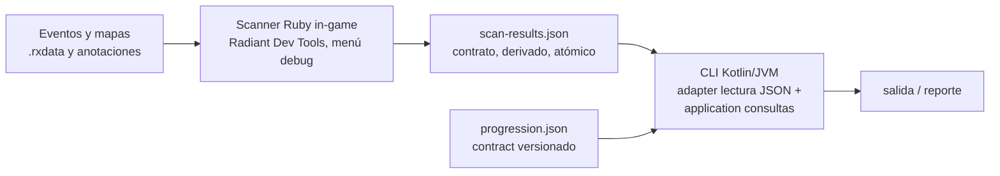
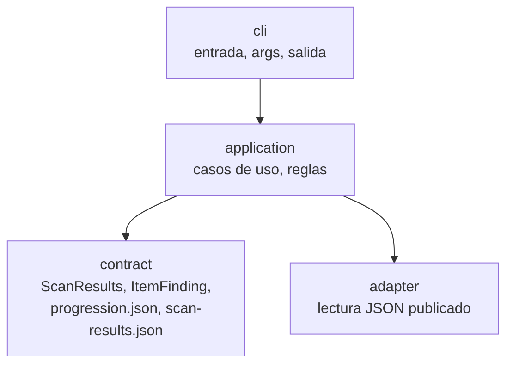
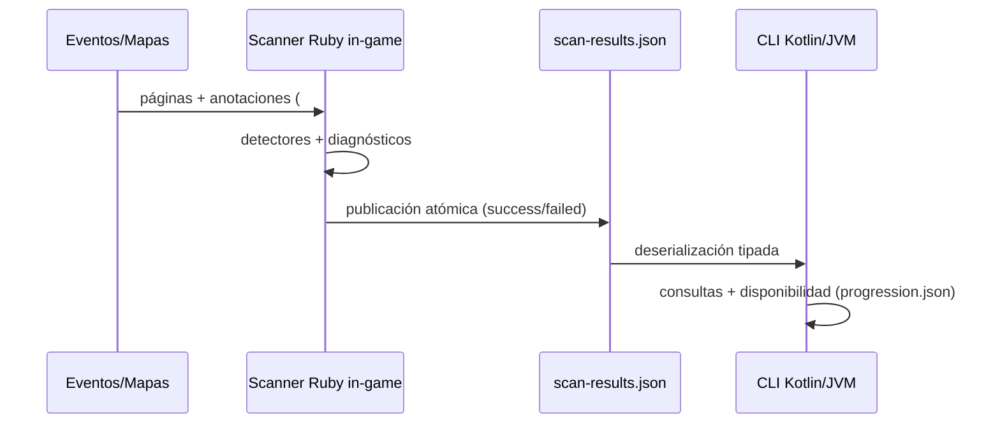

# Diseño — Scanner solo-lectura + catálogo de progresión

> [!note] Documento único de diseño y seguimiento ODD
> Español neutro/profesional porque extiende los planes existentes en español. Localizador repo-relativo: `radiant-platinum-docs/plans/Evolución del sistema de escaneo y progresión/odd/scanner-progresion.md` — Espejo Engram: tópico `odd/scanner-progresion/tasks`, proyecto `radiant-platinum`.

## 1. Objetivo

Construir el primer slice verificable del sistema de escaneo y progresión:

- Scanner **Ruby in-game** (acción del menú debug) que publica `scan-results.json`; CLI **Kotlin/JVM solo-lectura** que lo deserializa y reporta.
- Catálogo inicial de progresión (`progression.json`) con solo 3 capacidades aprobadas.
- Sin escritura en PBS, sin edición de juego, sin capas prematuras.

## 2. Problema / Por qué

- Hoy el escaneo legacy está en Ruby, disperso (MTs/objetos vs. eventos/stages) y sin contrato explícito de salida.
- La progresión por líderes/mochila no tiene un catálogo explícito y auditable.
- Sin este slice no se puede probar el límite Ruby → JSON → Kotlin.

## 3. Alcance autorizado

**Incluye:**

- Lectura de `.rxdata` y anotaciones necesaria para el slice 1 (verificado en código: el plugin no lee PBS).
- Publicación de `radiant-devtools/artifacts/scan-results.json` por la acción Ruby del menú debug (derivado, regenerable, ignorado por Git); la CLI Kotlin solo lo lee.
- Catálogo `radiant-devtools/catalogs/progression.json` con:
  - `rock_smash` desbloqueada en stage 3.
  - `cut` desbloqueada en stage 6 (stage 5 termina al vencer a Gardenia).
  - `bike` desbloqueada en stage 6.

> Procedencia: decisión de usuario 2026-09-22 + correcciones de 19 stages con descriptions; volcado a [[contracts#progression.json]] y campo `description` a [[domain-models#stage]].
- Paquetes Kotlin mínimos y provisionales: `cli`, `application`, `contract`, `adapter`; `application` ya expone el puerto propio `ScanResultsRepository` para el resumen del scan.

**No incluye (explícitamente diferido):**

- `strength`, `surf`, `rock_climb`, `waterfall`.
- Escritura en PBS o en datos del juego.
- Refactor del scanner Ruby legacy.
- UI, CLI completa, Gradle publication, PRs.

## 4. Restricciones

- Trabajo incremental con aprobación antes de escribir contratos aceptados o ficheros de implementación.
- Ciclo: decidir o cubrir una fase → resolver dudas → registrar en este doc → revisión del usuario → continuar.
- Heurística de planificación: ~400 líneas autoradas por tarea (orientativo, no es criterio de aceptación ni tope duro).
- No inventar rutas de código no verificadas: lo no mapeado va a `Gaps` como supuesto.
- Ruta de implementación: directa delegada cuando toque escribir ≥2 ficheros; hoy el mapeo automático no estaba disponible y se hizo directo inline (ver §11).

## 5. Arquitectura propuesta (provisional)

Kotlin **nunca** abre `.rxdata`: solo lee el JSON publicado ([[Guía de implementación]]).

Paquetes (mínimo para probar el borde):

- `contract`: modelos serializables + contratos JSON. Sin lógica.
- `adapter`: lectura del JSON publicado hacia `contract` (nunca `.rxdata`).
- `application`: consultas y resumen sobre el JSON; esta task solo organiza el caso de uso de reporte y no introduce disponibilidad ni progresión.
- `cli`: invoca un caso de uso y pinta el resultado.

El puerto de lectura permanece dentro de `application`; no se introduce una capa `repository` independiente.

## 6. Contratos por referencia (sin duplicar)

### 6.1 `scan-results.json` (salida del scanner)

Contrato normativo completo vive en [[contracts]].
Este doc no lo duplica; solo fija:

- Raíz explícita con colecciones de hallazgos + reglas de `status`.
- `missing_stage` = **warning** (omite el `ItemFinding` local, no bloquea el scan).
- Stage declarado pero desconocido = **error** (impedimento).

Comportamiento normativo aplicable (ver [[contracts]], no duplicado aquí):
- Estado: warnings → `success`; cualquier error → `failed`; diagnósticos en la raíz ([[contracts#Contenedor de resultados]]).
- Diagnósticos: `code`, `severity`, `message`, `source` estructurado ([[contracts#Diagnósticos del scanner]]).
- Caché: firma + metadatos controlan reutilización; resultado `failed` fuerza escaneo completo ([[contracts#Caché del scanner]]).
- Límites: el repositorio carga mapas, `MapWalker` crea contextos de página; ninguno escribe resultados ni consulta caché ([[contracts#Acceso a mapas]], [[contracts#Recorrido de mapas]]).
- Formas de entrega: `pbItemBall`, `pbReceiveItem`, `dar_mt`, `pbPokemonMart` ([[contracts#Registro de objetos obtenibles]]); `#alma` y `#requires` con sus reglas ([[contracts#Registro de almas]]).

### 6.2 `progression.json` (catálogo aprobado T1)

Catálogo normativo completo (19 stages, forma `stages[].unlocks` + `schema_version: 1`): ver [[contracts#progression.json]]. Mapa aprobado:

| Capacidad | Stage # | Stage ID |
|---|---|---|
| `rock_smash` ("Golpe Roca") | 3 | `stg_c4h1` |
| `cut` ("Corte") | 6 | `stg_f7n2` |
| `bike` ("Bicicleta") | 6 | `stg_f7n2` |

> [!info] Nombres de capabilities propuestos, editables. Diferidos: `strength`, `surf`, `rock_climb`, `waterfall`.

### 6.3 Flujo de hallazgos

## 7. Checklist ODD (estable, no reescribir IDs)

> Detalle revisable por checkpoint: [[ruby-producer-plan]].

- [x] **T1** — Catálogo `progression.json` 19 stages aprobado 2026-09-22 y volcado a [[contracts]] (rock_smash→3, cut→6, bike→6; diferidos fuera).
- [x] **T2** — Mapear 4–8 ficheros Ruby reales del scanner legacy (verificado 2026-09-22 con explore/Luna: `Plugins/[Z_CUSTOM_008] Radiant Dev Tools/001-003`, `Data/Scripts/025_Overworld/004_Overworld_FieldMoves.rb`, `Data/Scripts/028_Items/001_Item_Utilities.rb`, `PBS/map_metadata.txt`; `radiant-devtools/` vacía, sin `progression.json` ni `scan-results.json`).
- [x] **T3** — Contrato raíz verificado por referencia: seis claves (`schema_version`, `status`, `items`, `souls`, `tutor_stations`, `diagnostics`), sin claves extra; `failed` si hay ≥1 error; disponibilidad calculada en memoria por la CLI ([[contracts#Contenedor de resultados]]).
- [x] **T4** — Esqueleto Kotlin `contract` en el repo de la herramienta (tipos `scan-results.json`: findings, status, diagnostics + test de forma G3). Verificado 2026-09-23 con `.\gradlew.bat test` (BUILD SUCCESSFUL). El test directo de deserialización se eliminó después: los DTOs solo fijan forma, la lectura se prueba en T5 con `ScanResultsReader`.
- [x] **T4-K0** — Materializar y validar `radiant-devtools/catalogs/progression.json` como dependencia previa a la validación de anotaciones Ruby; comprobaciones completadas y commit `b4884a7` ([[ruby-producer-plan#T4-K0: Materialize the progression catalog]]).
- [x] **T4-R0** — Aislar legacy: mover `001-003` a `legacy/` dentro del plugin sin cambios de contenido (commit `c5d5a9d2` solo-move, renames 100%); entradas debug viejas verificadas en juego por el usuario 2026-09-25 ([[ruby-producer-plan#T4-R0: Isolate legacy code]]).
- [x] **T4-R1** — Acceso Ruby reutilizable: `MapRepository` + `MapWalker` + `PageContext`; aprobado y committed en `5c1d2a17` ([[contracts#Acceso a mapas]], [[contracts#Recorrido de mapas]], [[contracts#Contexto de página del scanner]]; [[ruby-producer-plan#T4-R1: Reusable map access and traversal]])
- [x] **T4-R2** — Anotaciones y primer detector `pbReceiveItem`; aprobado y committed en `9331b6ef` (`#addToRadar`, `#stage`, `#requires`, tags, notes; warnings `missing_stage` / `unregistered_content`; [[ruby-producer-plan#T4-R2: Annotations and first item detector]]). `pbItemBall` corresponde a la extensión T4-R2a.
- [x] **T4-R2a** — Aprobada y verificada en runtime; commit `e1f18891` (`feat(scanner): publish verified scan artifacts (T4-R3)`): el detector reconoce `pbItemBall` con el mismo contrato de `ItemFinding` que `pbReceiveItem` (ID de objeto simbólico y cantidad numérica opcional; [[ruby-producer-plan#T4-R2a: Extend item delivery detection]]).
- [x] **T4-R3** — Aprobada y verificada en runtime; commit `e1f18891` (`feat(scanner): publish verified scan artifacts (T4-R3)`): `ScannerCoordinator` + diagnósticos + `AtomicJsonWriter` + acción debug nueva (`:radiant_scan_slice1`) publican `radiant-devtools/artifacts/scan-results.json` ([[ruby-producer-plan#T4-R3: Coordinate and publish the result]]).
- [x] **T5** — `adapter` de lectura del JSON publicado para el slice 1 (sin `.rxdata`); verificado contra el JSON real de T4-R3 mediante la ejecución CLI de este batch, sin fixtures.
- [x] **T6** — `application` + `cli` que resume un `scan-results.json` publicado por Ruby en un caso de prueba; la implementación refactorizada conserva el comportamiento del primer slice y queda reconciliada con la evidencia observada. Reabierta para integrar Koin en la composición del CLI sin cambiar consumidores constructor-inyectados ni el comportamiento actual.
- [x] **T6-A** — Organizar el caso de uso de reporte de scan y preservar la localización completa de los diagnósticos; cambio directo delegado, activa varios ficheros de código y pruebas. Checks observados: `./gradlew.bat test --rerun-tasks --console=plain` (BUILD SUCCESSFUL) y `git diff --check` (sin salida).
- [ ] **T7** — Verificación funcional del slice (un caso pasa, warnings no bloquean, error bloquea).

Total tareas: 13 (T1–T7 estables + T4-K0 + T4-R0–R3 + T4-R2a).

## 8. Criterios de aceptación del slice 1

1. `progression.json` contiene exactamente las 3 capacidades aprobadas con sus stages.
2. La acción Ruby publica un `scan-results.json` válido y la CLI Kotlin lo resume con sus diagnósticos.
3. Una página con `missing_stage` genera warning y no bloquea el scan completo.
4. Un stage declarado pero desconocido genera error.
5. Ningún código del slice escribe en PBS ni en datos del juego.
6. Una página sin `#addToRadar` genera warning de contenido no registrado, sin hallazgo (distinto del `missing_stage`).

## 9. Checks aplicables (por tarea, no por checkbox de revisión)

- Compilación y ejecución Kotlin con Gradle Wrapper: `./gradlew run --args="<área> <acción> [opciones]"` ([[Guía de implementación#CLI]]); áreas previstas: `doctor`, `progression`, `scan`, `items`, `machines`, `tutors`, `souls`; códigos de salida 0/1/2/3.
- Ejecución del caso de prueba con `scan-results.json` observable.
- Lectura estructural del diff (pasivo, sin ceremonia pesada).
- La revisión nativa corresponde al padre y fue gestionada allí; en este repo rigen checks funcionales ordinarios.
- TDD: desactivado únicamente para el batch T6 CLI del 2026-10-11 por decisión explícita del usuario; no cambia la política general del proyecto.

## 10. Progreso / Evidencia / Siguiente paso

- **Progreso:** 2026-09-22 — creado este doc único en `odd/tasks` por decisión explícita del usuario. Mapeo automático no disponible (transporte OpenCode), se continúa inline con lo verificado en memoria.
- **Movimiento:** 2026-09-22 — movido a `radiant-platinum-docs/plans/Evolución del sistema de escaneo y progresión/odd/` a petición del usuario. Ubicación anterior `odd/tasks/scanner-progresion.md` eliminada para mantener documento único.
- **Evidencia:** decisiones de memoria #509 (catálogo inicial) + preferencia de ciclo incremental con aprobación.
- **G3:** aprobado por el usuario 2026-09-23. Queda fijado `./gradlew run --args="scan --map <map_id>"` sin prefijo `radiant`; `pbReceiveItem` produce `ItemFinding`; `missing_stage` es warning para `#addToRadar` sin `#stage`; `unregistered_content` es warning distinto para `pbReceiveItem` reconocido sin `#addToRadar`; los warnings conservan `status: "success"`; `Diagnostic.source` es un objeto estructurado de localización de página.
- **T4-R2a/T4-R3:** aprobadas y verificadas en runtime; commit `e1f18891` (`feat(scanner): publish verified scan artifacts (T4-R3)`). El artefacto observado en `radiant-devtools/artifacts/scan-results.json` tiene `schema_version: 1`, `status: "success"`, `POKEBALL x1` vía `pbItemBall` en `stg_a1f3`, y `POTION x3` vía `pbReceiveItem` en `stg_c4h1` con `requires: ["rock_smash"]`; conserva tags `hidden`/`gift` y la nota exacta `Hidden reward in the eastern room`, con `souls`/`tutor_stations` vacíos y solo warnings `missing_stage` y `unregistered_content` (sin errores).
- **Ruta y trigger:** ejecución delegada al escritor directo porque se cambiaron el código y dos documentos de seguimiento; CodeGraph mapeó la firma real `pbItemBall(item, quantity = 1, outfit_change = nil)`; no se declara ejecución directa inline. Trigger = aprobación explícita de G3 y solicitud de continuar con la siguiente task.
- **Siguiente paso:** verificar manualmente el caso de error con un artefacto `failed` y sus diagnósticos; mantener T7 pendiente hasta demostrar que los errores producen un resultado no utilizable y el código de salida correspondiente. La cobertura automatizada de CLI también queda pendiente.
- **Historia T6-A:** la implementación previa del usecase fue un cambio histórico no comprometido en `radiant-devtools`; un commit anterior fue deshecho por el usuario y no representa el estado staged actual.
- **T6-A autorizado:** reorganizar `GetScanReport`/`ScanReport` bajo `application.scan.report`, eliminar el request wrapper de un único parámetro opcional, mantener el filtrado/status/usability y la limitación actual de tutor stations, y conservar `Diagnostic.source` completo incluida la nulabilidad. No incluye CLI, adapter wiring, schema, disponibilidad/progresión ni commits.
- **T6-A aceptación y checks:** añadir regresiones para el argumento directo `MapId`, igualdad completa de `Source` y `source = null`; previsión orientativa de ~100–200 líneas cambiadas; ejecutar `./gradlew.bat test --rerun-tasks --console=plain` y `git diff --check`; pedir confirmación ante riesgo.
- **T6 CLI autorizado 2026-10-11:** implementar solo el código de la CLI Kotlin/JVM standalone para `scan` y `scan --map <positive integer>`, cableando el lector JSON, repositorio y caso de uso existentes. No se crean ni modifican tests; TDD queda desactivado expresamente para este batch. Se mantienen pendientes T7 y la cobertura automatizada de CLI.
- **T6 CLI alcance y verificación:** salida humana con estado, usabilidad, conteos, hallazgos y diagnósticos con localización segura; códigos 0/1/2/3 según el contrato de [[Guía de implementación#CLI]]. Checks obligatorios: `compileKotlin --rerun-tasks`, las tres ejecuciones Gradle `run` (`scan`, mapa 2 y mapa desconocido), y `git diff --check`, todos en primer plano y una vez cada uno. Forecast orientativo: ~80–150 líneas de código/build, sin tests; trigger de ruta delegada si se modifican 2+ ficheros no triviales; estrategia `ask-on-risk`.
- **T6 CLI estado:** el código fuente no tiene autoridad para commits ni para modificar artefactos reales, PBS, Ruby o datos del juego. El cierre de T6 solo podrá marcarse cuando se demuestre el resultado JSON real; una ejecución exitosa por sí sola no cierra T7. T5 solo se reconcilia con evidencia observada del artefacto real.
- **T6 CLI evidencia 2026-10-11:** `compileKotlin --rerun-tasks --console=plain` terminó `BUILD SUCCESSFUL` sin warnings. `run --args="scan"` y `run --args="scan --map 2"` terminaron con Gradle/child process efectivos en exit 0, `status: success`, usable, 2 items, 0 souls, 0 tutor stations, 2 warnings y 0 errors; se observaron `POKEBALL x1` y `POTION x3`. `run --args="scan --map 999999"` terminó con Gradle/child process efectivos en exit 0 y reporte vacío válido. `git diff --check` no encontró errores (solo advertencia de normalización LF→CRLF de Git para `build.gradle`). T6 no cierra T7; no se ejecutaron tests automatizados por decisión explícita del usuario.
- **T6 CLI tamaño y ruta:** cambio refactorizado de 202 líneas de código/build, dentro del forecast ~180–280; ruta delegada al escritor directo por el trigger de 2+ ficheros no triviales, no inline, estrategia `ask-on-risk`. Sin work-unit commit, integración, receipt ni claim de revisión; evaluación nativa explícita: riesgo medio, 8 changed paths, 202 changed lines, review_due false, under_budget.
- **T6 CLI reabierto 2026-10-11:** el usuario aprobó refactorizar la CLI directamente, preservando el comportamiento del primer slice. Se mantienen como evidencia histórica las ejecuciones previas de la implementación monolítica; T6 no se marcará completo hasta repetir los checks sobre la arquitectura corregida.
- **T6 CLI refactor autorizado 2026-10-11:** `Main.kt` queda como entrada mínima; `CliComposition.kt` compone dependencias; `CliApplication.kt` despacha comandos registrados; `CliCommand.kt` define el contrato mínimo; `scan/ScanCommand.kt` posee parsing, clasificación y sink; `scan/ScanReportRenderer.kt` es render puro. Sin nueva funcionalidad, dependencias, tests, cambios de contratos/usecase/repository, ni `exitProcess` fuera de `Main.kt`.
- **T6 CLI ruta y riesgo 2026-10-11:** trigger de ruta delegada confirmado por cambio en 2+ ficheros no triviales; forecast orientativo ~180–280 líneas de código/build y tracking. Estrategia `ask-on-risk`: el umbral de 400 líneas es asesoría, sin code-golf ni expansión de alcance.
- **T6 CLI refactor evidencia 2026-10-11:** se implementaron los límites aprobados en `cli/` y se preservó el primer-slice reportado para `scan`, `scan --map 2` y `scan --map 999999`; `compileKotlin`, las cuatro ejecuciones Gradle, `installDist`, los tres smoke checks del launcher instalado y `git diff --check` fueron observados. El launcher directo requirió JAVA_HOME al JDK 24 del toolchain solo para ese proceso; los procesos CLI válidos terminaron con 0 (`--help`) o 2 (comando/mapa inválido), con errores de uso solo en stderr. El padre repitió `./gradlew.bat run --args="scan --map 2" --console=plain` con BUILD SUCCESSFUL, success, usable, 2 items, 2 warnings y 0 errors contra el JSON real. T6 queda completada para el resultado de implementación; no hay work-unit commit, integración ni receipt. T7, tests y commits siguen pendientes.
- **T6 Koin autorizado 2026-10-11:** el usuario autorizó añadir Koin a la CLI Kotlin/JVM standalone y aplicarlo al grafo existente, preservando consumidores con inyección por constructor, arquitectura extensible de comandos y comportamiento vigente. Implementación acotada a `koin-core:4.2.2`, módulo DI bajo `cli`, composición aislada por invocación y cierre en `finally`; no se añaden comandos, funcionalidad ni tests.
- **T6 Koin ruta y alcance 2026-10-11:** cambio directo delegado por afectar varios ficheros no triviales; TDD desactivado por instrucción vigente y estrategia `ask-on-risk`. Forecast ~70–130 líneas para la integración Koin sola, acumulado ~250–330 líneas autoradas frente a HEAD. Se conserva la ejecución con Gradle Wrapper y los checks funcionales/smoke indicados; no se ejecutan tests.
- **T6 Koin evidencia 2026-10-11:** `compileKotlin --rerun-tasks --console=plain` terminó `BUILD SUCCESSFUL`; `run` para `scan`, `scan --map 2`, `scan --map 999999` y `--help` terminó en 0, conservando respectivamente el reporte real con 2 items/2 warnings, el mismo reporte filtrado, el reporte vacío válido y la ayuda. `installDist` terminó `BUILD SUCCESSFUL`; el launcher instalado terminó en 0 para `--help`, 2 para `unknown-command` y 2 para `scan --map 0`, con salida normal en stdout y errores de uso en stderr. `git diff --check` no encontró errores; las advertencias observadas son solo de normalización LF→CRLF. El contexto Koin aislado se cierra en `finally` antes de `exitProcess`; no se cierran los streams suministrados.
- **T6 Koin tamaño observado 2026-10-11:** el estado local suma 235 líneas cambiadas observables frente a HEAD incluyendo el trabajo CLI previo, el build y el lector aprobado; la integración Koin sola se mantiene dentro del forecast ~70–130 líneas. No hay tests ejecutados, work-unit commit, staging, integración, receipt ni claim de revisión. T6 queda completada; T7 y el caso failed siguen pendientes.
- **T6 Koin refinamiento autorizado 2026-10-18:** separar las definiciones compartidas en `appModule()` bajo `com.jclopez.radiant.devtools.di`, renombrar el módulo de CLI a `presentationModule()` con streams cualificados privados y binding nombrado de comandos, conservar `runCli` como composición CLI aislada que carga ambos módulos, y validar nombres de comandos duplicados antes de `associateBy`; sin cambios en consumidores, contratos, parser, renderer, `Main`, dependencias ni comportamiento de salida. Se mantiene explícitamente la instrucción humana de no crear, modificar ni ejecutar tests (TDD desactivado para este batch). Checks previstos: `compileKotlin --rerun-tasks --console=plain`, cuatro ejecuciones `run`, `installDist`, tres smoke checks del launcher instalado y `git diff --check`; ruta delegada por afectar varios ficheros no triviales, forecast orientativo ~50–100 líneas autoradas adicionales, estrategia `ask-on-risk`, sin commit ni integración.
- **T6 Koin refinamiento evidencia 2026-10-18:** `compileKotlin --rerun-tasks --console=plain` y las cuatro ejecuciones Gradle `run` terminaron `BUILD SUCCESSFUL`; `scan` y `scan --map 2` observaron el JSON real con 2 items (`POKEBALL x1`, `POTION x3`), 2 warnings y 0 errors; `scan --map 999999` produjo un reporte vacío válido; `--help` imprimió la ayuda. `installDist` terminó `BUILD SUCCESSFUL`; el launcher instalado con JAVA_HOME al JDK 24 terminó en exit 0 para `--help` con salida solo en stdout, exit 2 para `unknown-command` y `scan --map 0` con errores solo en stderr. `git diff --check` no encontró errores (solo advertencias de normalización LF→CRLF). El guard de nombres duplicados quedó verificado estructuralmente, pero no se ejerció un caso runtime negativo porque no se añadieron tests ni harnesses; T6 queda completada para este refinamiento, T7 y el caso `failed` siguen pendientes, sin commit, integración ni receipt.
- **Aclaración de arquitectura autorizada 2026-10-18:** `appModule()` es el agregador de módulos de la aplicación y recibe el módulo de presentación desde la raíz de composición; sus definiciones concretas se extraen a `dataModule()` y `useCaseModule()`. Esto refleja el `application`/use-case existente sin inventar clases, paquetes o una capa `domain` vacía. Sustituye la restricción anterior que impedía incluir el módulo de presentación porque la presentación se suministra genéricamente desde composición.
- **T6 Koin agregación de módulos reabierta 2026-10-18:** queda pendiente repetir los checks finales sobre `AppModule` agregador, `DataModule`, `UseCaseModule` y la composición con un único `appModule(presentationModule(...))`; se mantienen sin cambios los calificadores privados, el guard de nombres duplicados, el comportamiento de CLI, la instrucción de no tests/TDD desactivado, T7 pendiente y la prohibición de commit/integración.
- **T6 Koin agregación de módulos evidencia 2026-10-18:** `compileKotlin --rerun-tasks --console=plain`, las cuatro ejecuciones Gradle `run` y `installDist` terminaron `BUILD SUCCESSFUL`; el launcher instalado con JAVA_HOME al JDK 24 terminó en exit 0 para `--help` con salida solo en stdout, y exit 2 para `unknown-command` y `scan --map 0` con salida solo en stderr. Los casos `scan` y `scan --map 2` conservaron 2 items, 2 warnings y 0 errors del JSON real; el mapa 999999 produjo reporte vacío válido. `git diff --check` no encontró errores, solo advertencias LF→CRLF. AppModule quedó verificado como agregador puro con `dataModule()`, `useCaseModule()` y el módulo de presentación suministrado; no se ejecutó prueba negativa del guard, no se ejecutaron tests, no hay commit/integración, y T7/caso `failed` siguen pendientes.

## 11. Decisiones, supuestos y gaps

**Decidido:**

- Catálogo inicial = 3 capacidades en 19 stages (ver §6.2 y [[contracts]]). `cut` va en 6 porque stage 5 termina con Gardenia. Campo `description` opcional aprobado para el modelo stage.
- Paquetes mínimos `cli`, `application`, `contract`, `adapter`.
- `scan-results.json` lo publica Ruby (menú debug, atómico); Kotlin solo lee JSON, nunca `.rxdata` ([[Evolución del sistema de escaneo y progresión]] + [[Guía de implementación]]). Corrección 2026-09-22: el doc decía antes que Kotlin escaneaba y emitía — era falso contra los contratos.
- `missing_stage` es warning; stage desconocido es error.
- Contrato Kotlin usa un único `Source` con `kind`/`command` nullables (decisión de usuario: DTO simple, valida el lector); `ScanResult`/`payload` eliminados por redundantes con `ScanStatus`.
- Orden del slice (decisión de usuario 2026-09-25): contrato primero, productor Ruby mínimo después, consumidor Kotlin después. T5 espera al JSON real de T4-R3.
- T4-K0 materializó el catálogo versionado en `radiant-devtools/catalogs/progression.json`; las comprobaciones pasaron y el commit es `b4884a7`.
- Estructura Ruby en 3 bloques + coordinador + interfaz: `Map` (`MapRepository` + `MapWalker` + `PageContext`, infraestructura reutilizable, no exclusiva del scanner) → dominio (parser + validator + detectores) → aplicación (coordinador + `AtomicJsonWriter`) + acción debug como disparo.
- Legacy aislado en `legacy/` dentro del plugin (solo-move, commit `chore`, verificación de carga); borrado seguro cuando el nuevo scanner esté verificado. La nueva acción debug usa clave y métodos nuevos (`:radiant_scan_slice1`), sin contacto con los ficheros legacy.
- Código nuevo del plugin en inglés y organizado en carpetas por responsabilidad/layer; se permiten subcarpetas en el plugin.

**Supuestos resueltos en T2:**

- Scanners Ruby verificados en `Plugins/[Z_CUSTOM_008] Radiant Dev Tools/`; el plugin no lee PBS (solo `Data/MapInfos.rxdata`).
- Comando Gradle definido en [[Guía de implementación#CLI]].

**Gaps que bloquean código:**

- G1: cerrado 2026-09-22 con T2 (mapeo verificado).
- G2: cerrado 2026-09-22 con T1 (catálogo aprobado y volcado a [[contracts]]).
- G3: aprobado por el usuario 2026-09-23 (detalle en §10).
